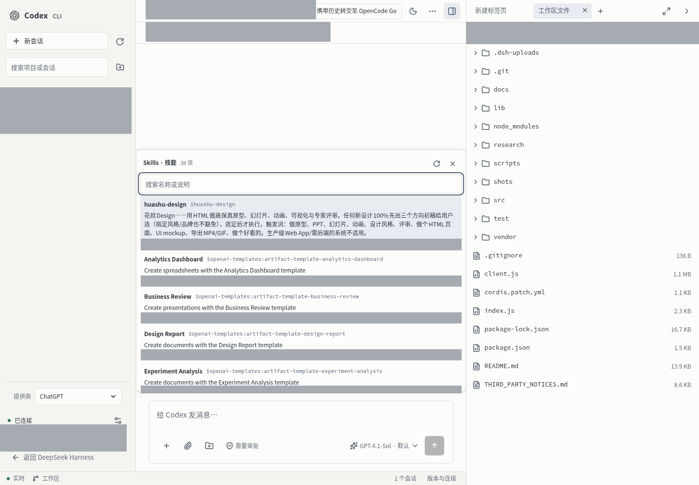

# dsh-codex-cli

在 DeepSeek Harness（DSH）的 Web 界面中使用和管理本机 Codex CLI 的插件。它将项目、会话、对话、审批和工作区工具集中在一个页面，适合希望通过浏览器操作运行在 DSH 宿主机上的 Codex 的用户。


## 功能范围

- **项目与会话**：按项目目录浏览、搜索和管理会话，支持新建、重命名、归档、分叉、导出和删除。
- **Codex 对话**：流式查看回复与工具调用，发送消息、运行中插话和停止；处理命令、文件变更等审批，切换模型、推理强度、权限与计划模式。
- **技能**：输入 `/skill` 打开可搜索的技能列表；输入 `$` 快速选择技能，选择结果随消息发送。
- **工作区文件**：浏览文件，预览支持的文件类型；右键上传、删除、复制路径、下载或引用到对话。文件删除会移入工作区的 `.dsh-trash`。
- **Git 版本管理**：查看本地变更和差异、选择文件提交、浏览提交图，以及操作分支、远程仓库和贮藏，查看命令记录。无需单独运行 dsh-git-vcs 插件。
- **其他工具**：在工作区中运行命令、打开浏览器标签；查看 Codex CLI 状态并使用界面提供的版本管理与健康检查。

插件运行在 DSH 宿主机上，操作的是**该宿主机**上的 Codex 会话、文件和 Git 仓库。它不提供 Codex 模型服务或账号，也不会替代 Codex CLI、Git 或 DSH。模型、技能及部分操作的可用性取决于所安装的 Codex 版本、账号和配置。

## 环境与兼容性

- **DSH**：插件声明要求 `>=0.2.1-rc.5`；目前在 `0.2.1-rc.5` 环境完成验证，其他版本尚未逐一验证。
- **Codex CLI**：需要可运行的 `codex` 和可用的登录或模型配置，插件通过 Codex app-server 通信。本次验证使用 `codex-cli 0.167.0`；最低兼容版本尚未确定，旧版本可能缺少部分接口。
- **运行环境**：当前验证环境为 Linux、Node.js `24.19.0`。其他系统与 Node.js 版本尚未完整验证；Git 功能还需要宿主机安装 Git。
- 浏览器访问 DSH 的方式与认证由 DSH 管理。插件使用宿主进程权限访问文件和运行操作，请只向可信用户开放 DSH。

## 安装

在安装了 DSH 的宿主机上获取源码，然后安装依赖并构建：

```bash
git clone https://github.com/TiChuXiXi/dsh-codex-cli.git
cd dsh-codex-cli
npm install
npm run build
dsh plugin --profile web add "$(pwd)"
```

若已通过其他方式取得源码，从 `cd` 后的步骤开始即可。这里的 `web` 是 DSH profile 名称；使用其他 profile 时请替换。

插件包自带 `cordis.patch.yml`，启用 bundle 后会插入 `codex-cli` 配置，无需再添加第二条 insert。首次安装或修改 bundle 后，按 DSH 的提示处理加载或重启；打开 DSH Web 界面，在左侧选择 **Codex CLI**。请先在宿主机确认 `codex --version` 可运行，并完成 Codex 登录或服务配置。

需要调整配置时，可在对应 profile 的用户 patch 中按 id 覆盖，例如：

```yaml
- id: codex-cli
  config:
    transport: auto
    codexPath: ''
    codexHome: ''
```

`transport: auto` 优先连接守护进程，失败时回退到独立的 stdio 进程；`codexPath` 留空时从 PATH 查找，`codexHome` 留空时使用 `CODEX_HOME` 或默认目录。

## 使用

1. 进入 **Codex CLI**，选择已有项目和会话，或新建项目目录及会话。
2. 在输入框发送消息；Enter 发送，Shift+Enter 换行。运行中可插话或停止，并在审批卡片中处理请求。
3. 在输入框输入 `/skill` 并按 Enter，或输入 `$` 搜索技能；使用方向键和 Enter/Tab 选择。
4. 打开右侧工作区，在文件树中右键文件、文件夹或空白区域进行对应操作；打开版本管理查看当前会话项目的 Git 状态。

工作区单文件上传上限为 25 MiB；下载针对单个文件，不提供目录打包下载。文件预览能力取决于文件类型。Git 写操作、终端命令和 Codex 操作会影响宿主机文件，请根据实际需要选择会话权限。

技能列表与工作区文件（截图中的个人信息已遮挡）：



## 开发与验证

```bash
npm install
npm run build
npm test
```

前端源码位于 `src/client/`，构建输出为 `client.js`；宿主端位于 `index.js` 和 `lib/`。测试包含临时 Git 仓库及本地模拟服务。浏览器和热加载验收依赖实际 DSH 环境，构建成功本身不代表实际页面已加载。

## 许可与第三方来源

本项目采用 [MIT 许可证](LICENSE)。第三方代码及许可证见 [THIRD_PARTY_NOTICES.md](THIRD_PARTY_NOTICES.md)，其中包括 Git 功能参考的 dsh-git-vcs。
