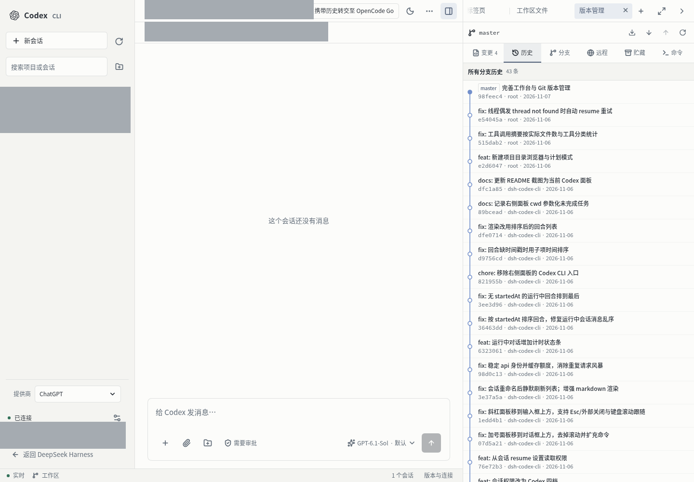

# dsh-codex-cli

把 Codex CLI 从命令行搬进 DeepSeek Harness Web GUI 的管理端插件：项目/会话管理、交互式对话、命令审批、版本与健康检查。



## 现在能做什么

- **项目与会话**：按 cwd 聚合本机 Codex 会话，显示会话数、运行中数量、git 分支、模型与最近活动；可搜索、分页加载。
- **交互对话**：打开任意历史会话，直接发消息、看流式输出、运行中插话（steer）、停止回合。
- **审批闭环**：命令审批、文件变更审批、用户提问以卡片形式出现在对话下方；在终端里批准过的请求会自动消失。
- **实时共享**：默认连接 Codex 守护进程，终端里正在跑的会话也能在网页里实时看到。
- **新会话**：选择目录、模型、推理强度、审批策略与沙箱后创建。
- **会话管理**：重命名、归档/取消归档、Fork、导出 markdown、永久删除（二次确认）。
- **版本与健康**：CLI / 守护进程 / 最新版、安装渠道、升级、回滚、守护进程重启/更新/停止、`codex doctor` 体检；长命令在后台跑并实时回显。

- **右侧栏 tab**：打开 DSH 会话的右侧栏，Codex tab 按该会话 cwd 列出项目内的 Codex 会话；点一条就切到主面板并选中。
- **渲染**：markdown（标题/列表/代码块/表格/链接）、本地图片懒加载预览（8MB 上限）。
- **滚动跟随**：贴着底部时自动跟随流式输出；用户上滚后停止跟随，右下角出现圆形按钮，点一下平滑回到底部并恢复跟随。
- **时间信息**：消息名旁显示本地时间（用户消息时间在前、Codex 在后），每个回合结束后显示「用时 X 分 Y 秒 · HH:MM」。
- **输入区**：对齐 DSH 默认 composer 的圆角卡片；模型与推理强度两级菜单（推理强度与 Codex TUI 一致：低/中/高/极高 + 「更多推理…」里的 Max/Ultra，共 6 档，带官方描述与「默认/当前」标记），选择随下一次发送生效；运行中显示状态点与停止键。

## 安装

```bash
dsh plugin --profile web add /root/project/dsh-codex-cli
```

然后在 profile 的用户 patch 层（`~/.dsh/profiles/web/cordis.patch.yml`）加一行：

```yaml
- insert:
    - id: codex-cli
      name: dsh-codex-cli
      inject: [connection, webServer]
      config:
        transport: auto
```

`patchReload: live` 会直接热加载，不需要重启 `dsh web`。

> **注意**：`dsh plugin add` 会把包同时写进 `dsh.profile.bundles`，而包自带的 `cordis.patch.yml` 也会插入同一行 `codex-cli`，重启后会出现重复行。本机采用「只在用户 patch 层插入」的方式，因此需要把 `dsh-codex-cli` 从 `dsh.profile.bundles` 里移除（依赖保留）。见 `docs/PLAN.md` 的安装说明。

## 使用

左侧栏点 **Codex**：

| 区域 | 作用 |
| --- | --- |
| 项目列表 | 「全部会话」或某个 cwd；点一下过滤右侧会话列表 |
| 会话列表 | 搜索、状态点、模型与相对时间；点开进入对话 |
| 对话区 | 消息、推理、命令、文件变更、工具调用（默认折叠，点开看详情） |
| 审批卡 | 命令/文件变更：允许、本会话允许、拒绝 |
| 输入区 | Enter 发送、Shift+Enter 换行；回合运行中按钮变「插话」，旁边是「停止」 |
| 顶栏 | 连接状态、传输方式（守护进程/独立实例）、Codex 版本、事件流状态、刷新、新会话 |

## 架构

```
浏览器（DSH Web）
 ├ main 面板：Codex 管理页
 │    POST /codex-cli/*（RPC 信封）   GET /codex-cli/events（SSE）
 └ 宿主进程（Cordis 插件）
      ├ Transport：daemon（WebSocket over Unix socket）→ stdio 兜底
      ├ JsonRpcClient：请求表、服务端请求、重连
      ├ CodexHub：线程/回合/审批/项目聚合
      └ EventBus：全局 seq、环形缓冲、增量合并
```

- 宿主半区：`index.js` + `lib/`，不 import 任何 `@deepseek-ai/*` 运行时值，服务全部走 `ctx.get()`。
- 浏览器半区：`src/client/`，由 `scripts/build-client.mjs`（esbuild）打成 `client.js`；`react` 保持 external。
- 协议类型：`research/codex-ts/`（`codex app-server generate-ts` 生成），schema 在 `research/codex-schema/`。

### 端点

| 端点 | 作用 |
| --- | --- |
| `status` | 连接状态、版本、配置、挂起审批 |
| `projects/list` | 按 cwd 聚合的项目 |
| `threads/list` / `threads/get` | 会话分页 / 会话详情（元数据 + 最近回合） |
| `threads/new` | 新建会话 |
| `threads/open` / `threads/close` | 订阅 / 释放实时事件 |
| `turns/start` / `turns/steer` / `turns/interrupt` | 发消息 / 插话 / 停止 |
| `approvals/pending` / `approvals/respond` | 审批补发 / 响应 |
| `threads/rename` `archive` `unarchive` `delete` `fork` `export` | 会话管理 |
| `versions/check` `update` `rollback` `job` | 版本探测与升级/回滚（后台 job） |
| `daemon/action` | 守护进程 start/stop/restart/update |
| `doctor/run` | `codex doctor --json` |
| `images/read` | 读本地图片转 data URL（png/jpg/webp/gif，≤8MB） |
| `models/list` / `config/read` | 选择器数据 |

SSE 事件：`hello`、`connection`、`thread/upsert`、`thread/status`、`turn/started`、`turn/completed`、`item/upsert`、`item/delta`、`item/patch`、`approval/requested`、`approval/resolved`、`mcp/status`、`thread/usage`、`resync`。

## 开发

```bash
npm install            # ws + esbuild
npm run build          # src/client -> client.js
npm test               # node --test
node scripts/smoke-host.mjs auto   # 不经过 DSH，直接连守护进程冒烟
```

宿主代码改动后，`touch ~/.dsh/profiles/web/cordis.patch.yml` 触发热重组；浏览器代码改动后刷新页面。

## 安全边界

- `/codex-cli` 所有请求先过 `ctx.connection.requestRejection()`（Host/Origin + 会话认证）。
- 不自动批准任何审批；无人响应时按 `approvalTimeoutMs`（默认 10 分钟）自动拒绝。
- 只连本机 Unix socket 或自己 spawn 的子进程，不监听网络端口。
- 历史与实时条目对超长输出/diff/JSON 做截断，避免一次拉回几 MB。
- `images/read` 只接受常见图片扩展名与 8MB 以内的文件；路径来自 Codex 的 `imageView` 条目，插件不主动遍历目录。
